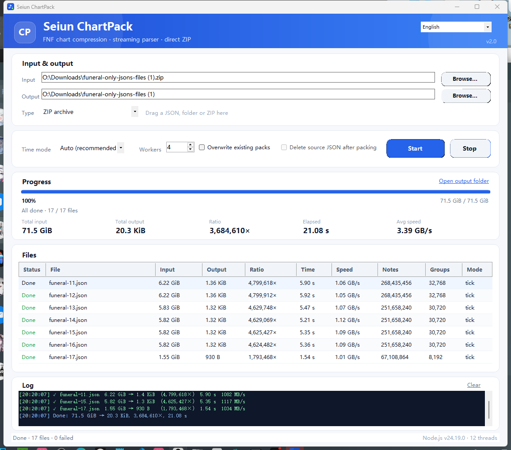

# chartpack — 流式、低内存的 FNF / Seiun Engine 谱面容器

## 一句话

chartpack.mjs 现在是**流式字节解析器**：不把谱面读进内存、不生成巨大的 sectionNotes 字符串，
直接从 **JSON 文件**或 **ZIP 压缩包内部**边解压边打包。76.8 GB 的 funeral 全套谱面从 ZIP 直接压成
**20,834 字节**，耗时 **23.5 秒**，峰值内存 **393 MB**（3 个 worker）。

容器格式仍然是原来的 SEIUNPK1 v1，引擎（source/ChartPack.hx）**不需要重新编译**。

## 图形界面（chartpack-ui.exe）

双击 **tools/chartpack/chartpack-ui.exe** 即可，不用敲命令：

- **输入类型是下拉框**：单个 JSON 文件 / 文件夹（多个 JSON）/ ZIP 压缩包；也可以直接把文件/文件夹拖进窗口。切换类型只改变“怎么读”，**不会把下拉框强行改回别的类型**；如果输入路径和所选类型不一致，点“开始打包”会提示改选类型。
- **右上角语言下拉框**：跟随系统 / 简体中文 / English，切换**立即生效**并记住选择；界面文字、表头、状态、日志模板、Node 提示都会切换。
- 实时进度条 + 每个文件的 **原始大小 / 输出大小 / 压缩比 / 用时 / 速度 / 音符数 / 分组 / 时间模式**。
- 底部日志显示计划、每个文件的完成情况、失败原因和最终汇总。
- 并发数、tick/float/自动、覆盖已有 pack、打包后删源 JSON 都可以在界面里选。
- 找不到 Node.js（需要 18+）会弹出提示：可以直接打开下载页，或手动选择一个 `node.exe`（绿色版）。
- exe 内置了 chartpack.mjs；如果 exe 同目录下也有 chartpack.mjs，会优先用同目录的（方便更新脚本）。
- 需要 Windows 10/11 自带的 .NET Framework 4.8；不需要安装其他运行时。
- 首次运行如果 Windows SmartScreen 提示“未知发布者”，点“更多信息 → 仍要运行”即可（本程序没有代码签名）。

**完全便携版**：`chartpack-ui-portable.zip`（约 34 MiB）里带了 `node.exe`，
解压后直接双击 `chartpack-ui.exe`，连 Node.js 都不用装。

重新构建：

    powershell -ExecutionPolicy Bypass -File tools/chartpack/build-ui.ps1 -Portable

## 实测

### funeral 全套（直接读 ZIP，不落地解压）

| 项目 | 数值 |
|---|---:|
| ZIP 内 17 个 JSON | **76,765,170,749 B（71.5 GiB）** |
| 生成的 17 个 chartpack | **20,834 B（20.3 KiB）** |
| 总压缩比 | **3,684,610×** |
| 总耗时（wall，--jobs=3） | **23.47 s** |
| 峰值内存（整个 node 进程树） | **392.8 MB** |
| 聚合吞吐 | **约 3.27 GB/s** |

单个文件：

| 文件 | 原 JSON | chartpack | 耗时 | 峰值内存 | 吞吐 |
|---|---:|---:|---:|---:|---:|
| funeral-15 | 6,253,577,326 B | **1,352 B** | 3.95 s | 190 MB | 1,595 MB/s |
| funeral-17 | 1,667,925,113 B | **930 B** | 0.82 s | 159 MB | 2,497 MB/s |

> 同一个 funeral-15 从本地 NVMe 直接读：**3.10 s**，峰值 **199 MB**，约 **2.0 GB/s**。
> 本机 NVMe 顺序读实测约 **3.1 GB/s**，单线程 zlib 解压这套高重复数据约 **1.5 GB/s**。
> 新工具在 ZIP 路径上基本是**解压/解析跑满**，不是磁盘等 CPU。

### 并发调优（同一套 ZIP，17 个 entry）

| --jobs | 耗时 | 峰值内存 |
|---:|---:|---:|
| 3 | 23.47 s | 393 MB |
| 4（默认） | **21.08 s** | **568 MB** |
| 6 | 20.92 s | 771 MB |

4 个 worker 已经接近 6 个的速度，但内存少 26%；默认取 4。

### 和旧版对比（funeral-17，1.66 GB）

| | 旧 chartpack-v1.mjs | 新 chartpack.mjs |
|---|---:|---:|
| 耗时 | 45.77 s | **0.82 s（56×）** |
| 峰值内存 | 2,145 MB | **159 MB（13×）** |
| 输出 | 31,673 B | **930 B（34×）** |

### 没有长重复段的普通谱面（2,000,000 条唯一 note，39 MB）

| | 旧版 | 新版 |
|---|---:|---:|
| 耗时 | 9.54 s | **2.23 s** |
| 峰值内存 | 2,625 MB | **230 MB** |
| 输出 | 6,312,726 B | **24,587 B** |

旧版在这份谱面上因为“6 位小数文本必须完全相等”的判定失败而退回 float64；新版用
1e-6 ms 的数值容差判定 tick 网格，因此仍然走 tick 模式。

## 为什么快 / 为什么小

1. **流式字节扫描**：按块（默认 8 MB）读文件或解压流，逐字节找 "sectionNotes"，
   把数组以外的字节直接写进 skeleton；每个数组只写一个 NUL 占位。
   全程不构造整段 sectionNotes 字符串，也不 Buffer.concat 整个谱面。
2. **字节级 note 解析**：直接解析 [time, lane, sustain(, type)]，支持任意空白、字符串类型、
   null 第四项；不依赖正则。跨块边界由极小的 leftover 缓冲处理。
3. **重复段快进（关键）**：funeral 每个 note 连续重复 **8192 次**。解析完一个 note 后，
   用 Buffer.compare 做指数倍增 + 二分确认，一次性数完整段相同文本：
   - 每个 run 只做约 2 × 8192 个 note 长度的 memcmp（约 400 KB）；
   - 250 M note 的谱面只真正解析约 3 万个 note，其余全部按 repeat 计数；
   - 因此吞吐能到 **1.5–2.5 GB/s**，而不是旧版 regex 的 30–40 MB/s。
4. **typed-array 分组表**：每个 section 用开放寻址哈希表 + Int32Array/Float64Array，
   每条 note 只做数值比较/自增，不创建 {tick,lane,...} 对象；只有出现新 key 才插入。
   如果新 key 本来就有序（FNF 谱面基本如此），排序也会跳过。
5. **tick 容差**：旧版要求 toFixed(6) 与源文本逐字符相等，funeral 的 9 位小数时间必然失败，
   整份文件要扫两遍（先 tick 失败、再 float 重扫）。新版只要求
   |tick*base - t| <= 1e-6 ms，这些谱面直接走 tick；组流从 8 字节/时间降到 1–3 字节 varint，
   再叠加 deflate，最终只剩几百字节到 1 KB 多。
6. **ZIP 直读**：解析 EOCD / ZIP64 中央目录，拿到 entry 的压缩区间，
   fs.createReadStream(start,end) → zlib.createInflateRaw() → 扫描器。
   不把 76 GB 解压到磁盘；每个 entry 一个 worker，--jobs=4（默认）在 6 核/12 线程上接近跑满。
7. **解包也是流式**：unpack 用 8 MB 输出缓冲逐段写 JSON，不会在内存里拼 6 GB 字符串；
   tick 模式时间按 6 位小数输出，float 模式按最短往返表示输出。

## 用法

单个文件：

    node tools/chartpack/chartpack.mjs pack   in.json   out.chartpack
    node tools/chartpack/chartpack.mjs unpack out.chartpack in.json
    node tools/chartpack/chartpack.mjs info   out.chartpack

整个目录（跳过 events.json / meta.json / *.parts.json）：

    node tools/chartpack/chartpack.mjs pack-dir "mods/.../data/funeral" --jobs=4
    node tools/chartpack/chartpack.mjs pack-dir "mods/.../data/funeral" --replace

分段谱面（多个 part 合成一首）需要 `<song>.parts.json` 显式列顺序。引擎的
ChartParts.detect 在发现 `<song>.chartpack` 时会拒绝自动编号，所以 base pack 存在时
manifest 是必须的；本目录已经生成 `funeral.parts.json`（1 → 17，共 3,087,007,744 note）。

**直接对着 ZIP 打包（不落地解压）：**

    node tools/chartpack/chartpack.mjs pack-zip "O:\Downloads\funeral-only-jsons-files (1).zip" --out-dir "O:\Downloads\funeral-only-jsons-files (1)" --jobs=4

只打某几个 entry：

    node tools/chartpack/chartpack.mjs pack-zip archive.zip --out-dir out --only=funeral-15.json,funeral-16.json,funeral-17.json

按名字过滤 + 覆盖已有 pack：

    node tools/chartpack/chartpack.mjs pack-zip archive.zip --out-dir out --match=funeral --force

语义验证（源 JSON 或 ZIP entry）：

    node tools/chartpack/chartpack.mjs verify     out.chartpack in.json
    node tools/chartpack/chartpack.mjs verify-zip out.chartpack archive.zip funeral-15.json
    node tools/chartpack/compare.mjs in.json unpacked.json

### 选项

| 选项 | 说明 |
|---|---|
| --jobs=N | pack-dir / pack-zip 的并发 worker 数，默认 min(4, 线程数/2)，本机为 4 |
| --time-mode=auto\|tick\|float | 默认 auto：先试 tick，失败自动整份重扫为 float |
| --chunk=BYTES | 本地文件读块大小，默认 8 MiB；ZIP 解压块默认 4 MiB |
| --force | 覆盖已有的 .chartpack |
| --replace | 仅 pack-dir：打包成功后删除源 JSON |
| --only=a.json,b.json | 仅 pack-zip：按 entry 的 basename 精确筛选 |
| --match=TEXT | 仅 pack-zip：entry 路径包含该子串 |
| --out-dir=DIR | pack-dir / pack-zip 的输出目录（默认源文件旁边 / ZIP 旁边） |
| --quiet | 不打印单文件 JSON 统计 |

## 内存模型

- 每个 worker 常驻约 **100–200 MB**（Node 基线 + 8 MB 读缓冲 + 当前 section 的分组表 + 骨架）。
- **从不**持有整份 JSON；skeleton 只保存 sectionNotes 之外的部分（funeral 只有 1.1 KB）。
- 分组表按 section 重置；2 M 个唯一 group 的极端 section 约 80 MB 表 + 输入缓冲。
- 解包输出按 8 MB 块写盘，不构造完整输出字符串。
- funeral 全套 3 worker 实测峰值 **393 MB**。

## 验证

17 个 pack 全部用 verify-zip 对 ZIP 内原始 JSON 做过逐 section 的多重集比对：

    funeral-10 OK   funeral-11 OK   funeral-12 OK   funeral-13 OK
    funeral-14 OK   funeral-15 OK   funeral-16 OK   funeral-17 OK
    funeral-2  OK   funeral-3  OK   funeral-4  OK   funeral-5  OK
    funeral-6  OK   funeral-7  OK   funeral-8  OK   funeral-9  OK
    funeral    OK
    ALL VERIFIED

比对内容：skeleton 的 MD5 完全一致、section 数一致、每个 section 的
(time, lane, sustain, type, repeat) 多重集完全一致、展开后的 note 总数一致。
时间按 0.01 ms 分桶（打包器的 tick 回算误差 ≤ 1e-6 ms）。

另外还覆盖了：

- 60 组随机谱面 fuzz（随机 run 长度、空白、类型字符串、空 section、3–1024 字节的块大小）；
- ZIP stored（method 0）与 deflate（method 8）；
- ZIP64（6.25 GB entry）；
- 旧版 float pack 的兼容解包与验证；
- 2 M 唯一 note、8192 长 run、空数组、"sectionNotes" 出现在普通字符串里等边界。

## 引擎兼容性

- 格式仍是 SEIUNPK1 v1：magic、header JSON、skeleton zlib、group stream zlib 完全一致。
- timeMode 仍是 tick / float；ChartPack.hx 已经支持两种。
- group 记录仍是 zigzag(tick delta), zigzag(lane), susIdx, typeIdx, repeat（tick 模式）
  或 double time, ...（float 模式）。
- 空 section 写 sectionGroups[i] = 0，引擎的 readNotes 返回空数组。
- 容器只多了一个 header 字段 v: 1（旧版也有）；引擎忽略未知字段。
- **不需要重新编译引擎**；把生成的 .chartpack 放到 data/<song>/ 即可。

引擎缓存 chart_cache/*.notes/.skel 的 key 包含每个源文件的 **size + mtime**，所以覆盖 pack 后
旧缓存会自动失效，不会读到旧内容。

## 已部署

O:\Downloads\funeral-only-jsons-files (1) 下的 17 个 pack 已全部替换为新版（含之前没打完的
funeral-15/16/17）：

- 旧 pack 备份在 _old-chartpacks-20261031-193435/（14 个，共 1,180,225 B）；
- 新 pack 共 17 个，共 20,834 B；
- 目录里的 funeral-15.json / funeral-16.json / funeral-17.json 原样保留（共约 14.2 GB）。
  现在 pack 已经验证通过，如果只是给引擎用，可以删掉这三个 JSON 释放空间。
- 已生成 funeral.parts.json，按 1 → 17 的顺序列出全部 17 个 pack（合计 3,087,007,744 note）。
  把整个目录作为 data/funeral 使用时请把它一起复制；没有它，引擎会因为 funeral.chartpack
  存在而只加载 base part，2–17 不会被合并。

## 限制

- note 必须是 3 或 4 个标量字段（标准 FNF 格式）。遇到 5 个以上字段会**报错**而不是像旧版那样
  静默丢弃该 note。
- BPM 必须出现在第一个 sectionNotes 之前的 64 KiB 内；找不到就整份走 float（仍然正确，只是更大）。
- ZIP 只支持未加密的 stored / deflate entry；不支持 ZIP 加密和 7z/rar。
- tick 容差是 1e-6 ms；时间不在 BPM 网格上的普通谱面会自动退回 float64。
- 解包后的 JSON **语义等价**，不是逐字节还原：同一 section 内 note 顺序、数字文本格式可能不同；
  tick 模式时间按 6 位小数输出，float 模式按最短往返表示输出。
- 旧实现保留为 chartpack-v1.mjs，仅作对照/回退，不再维护。